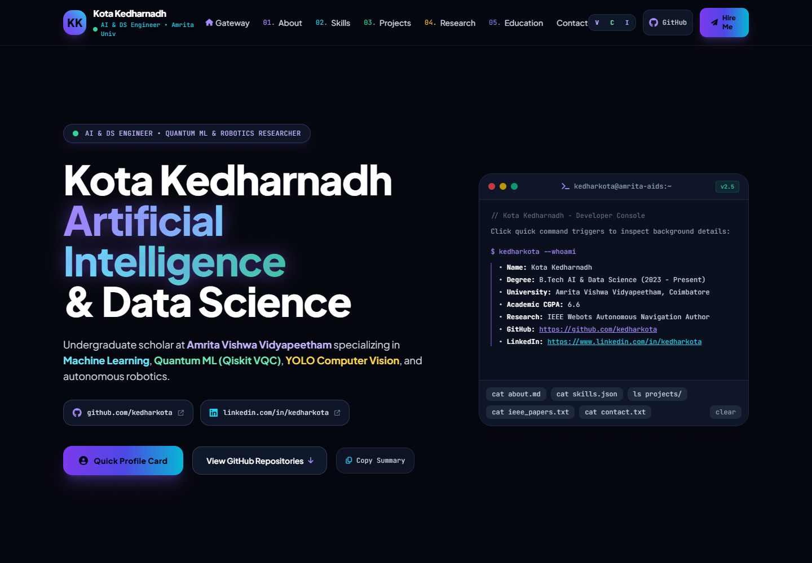
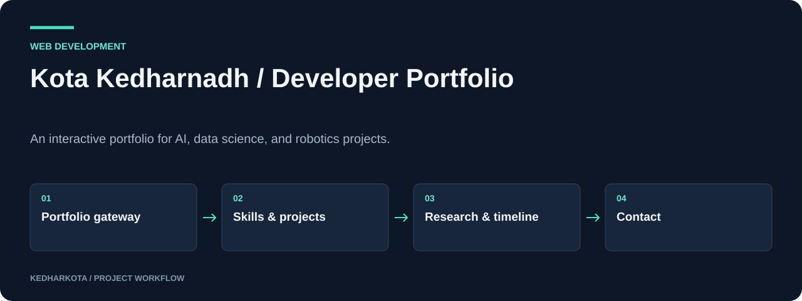

# Kota Kedharnadh · Developer Portfolio

An interactive portfolio for AI, data science, and robotics projects.

**HTML · CSS · JavaScript · Tailwind CSS**

[Overview](#overview) · [Getting started](#getting-started) · [Repository guide](#repository-guide) · [Reproducibility](docs/REPRODUCIBILITY.md)



*Portfolio main view rendered from the repository HTML.*

## Overview

A single-page personal portfolio that brings project work, research links, education, and contact options into one browsable interface. The page includes a gateway screen, theme controls, a developer-console interaction, and project detail modals.

## What this project includes

- Gateway and main portfolio views with section navigation.
- Three visual themes: Violet, Cyber, and Indigo.
- Project cards, research links, education timeline, and a command-style profile panel.
- Contact form that opens the visitor's email client, plus GitHub and LinkedIn links.

## Workflow



*Explanatory diagram. Detailed implementation and availability notes follow below.*

## Getting started

Requires Python 3 for the preview server and a modern browser. No Node.js build is required.

```bash
python -m http.server 8000
```

Open http://localhost:8000 and select **Enter Full Portfolio**. Internet access loads the Tailwind CDN, fonts, and icon stylesheet.

### Required inputs and current constraints

All page content lives in `index.html`. Before hosting, replace the machine-specific `file:///C:/...` background-image references with committed assets and relative URLs. Those background files are absent from this repository.

## Repository guide

| File | Purpose |
| --- | --- |
| [index.html](index.html) | Complete page, styles, interactions, and project content. |

## Results and project status

The screenshot below was captured from the committed HTML served over HTTP. The contact form uses `mailto:` rather than a server-side message service. Research and achievement statements on the page are author-provided portfolio content; this documentation does not independently verify those claims.

## Next steps

- Commit the referenced background images or remove their local file paths.
- Check navigation, project links, and contact actions on mobile before deployment.

## Documentation maintenance

Local documentation links and image headers are checked on pull requests and relevant pushes by the [documentation workflow](.github/workflows/docs.yml). Run the same check locally:

```bash
python tools/check_docs.py
```

See the [reproducibility guide](docs/REPRODUCIBILITY.md) for evidence, missing artifacts, and visual-source notes. The check validates documentation files; it does not train models or certify application behavior.

---

[More projects by kedharkota](https://github.com/kedharkota?tab=repositories)
