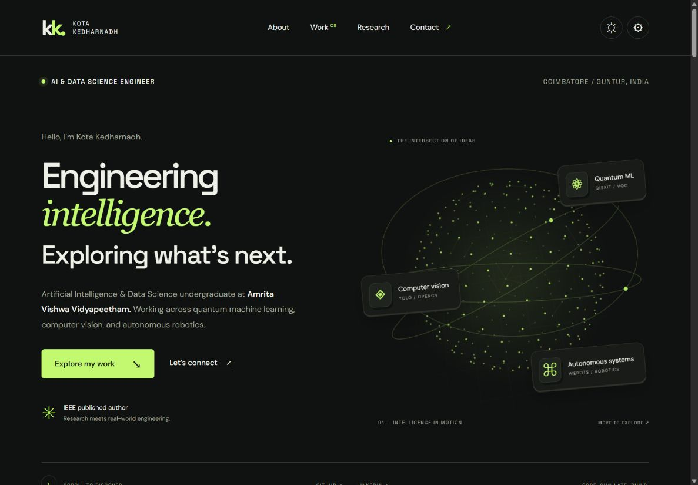

# Kota Kedharnadh · Interactive Portfolio

AI, data science, quantum machine learning, and robotics — presented through an interactive, responsive portfolio.

**HTML · CSS · JavaScript · Canvas 2D with 3D projection**

[Open the live portfolio](https://kedharkota.github.io/My-Portfolio/) · [Projects](https://kedharkota.github.io/My-Portfolio/#projects) · [Research](https://kedharkota.github.io/My-Portfolio/#research)

[](https://github.com/kedharkota/My-Portfolio/actions/workflows/docs.yml)



## The experience

- An interactive particle sphere and inclined orbital rings, projected in three dimensions and responsive to pointer movement.
- Floating icons, subtle project-card tilt, scroll reveals, and a reading progress indicator.
- Light/dark mode, Lime/Violet/Ice accents, and an ambient-motion toggle. Preferences persist on the visitor's device.
- Eight existing project entries with category filters, desktop grid/list views, and keyboard-accessible project dialogs.
- Profile tabs, a multidisciplinary skills section, IEEE publication links, and an education timeline.
- Responsive mobile navigation, keyboard focus states, and reduced-motion support.
- Email and WhatsApp contact actions that prepare a message in the visitor's chosen app.

## Run locally

No package installation or build step is required. Serve the repository with Python 3:

```bash
python -m http.server 8000
```

Open http://localhost:8000. The page loads directly into the portfolio. Google Fonts is optional; local font fallbacks are provided. The page has no runtime JavaScript framework or external icon dependency.

## Repository guide

| File | Purpose |
| --- | --- |
| [index.html](index.html) | Complete page, embedded styles, JavaScript, and original portfolio content. |
| [portfolio-preview.jpg](portfolio-preview.jpg) | Browser screenshot of the redesigned desktop experience. |
| [docs/REPRODUCIBILITY.md](docs/REPRODUCIBILITY.md) | Verification scope and visual provenance. |
| [tools/check_docs.py](tools/check_docs.py) | Local documentation link and image-header checker. |

## Content and verification

The redesign preserves the author's existing profile information, eight project entries, education records, research links, grades, and contact details. Research and achievement statements are author-provided; the visual redesign does not independently verify them.

Desktop and phone layouts were inspected in a browser. Theme/accent persistence, the motion toggle, project filters, grid/list views, project dialogs, profile tabs, and mobile navigation were exercised. The orbital scene is a generative illustration, and project diagrams are concept visuals rather than screenshots or measured experiment results.

The contact form does not use a server or store submissions. Email opens the visitor's email client; WhatsApp opens a prepared chat. The visitor completes sending in that app.

## Documentation checks

```bash
python tools/check_docs.py
```

The checker validates local documentation links and image headers. It does not assess the underlying project models or certify research outcomes.

## Explore more work

- [All repositories](https://github.com/kedharkota?tab=repositories)
- [Video Deepfake Detection](https://github.com/kedharkota/AI-deep-fake-detection)
- [Gesture-Controlled Drone Simulation](https://github.com/kedharkota/Gesture-Controlled-Drone-)

[GitHub](https://github.com/kedharkota) · [LinkedIn](https://www.linkedin.com/in/kedharkota)
